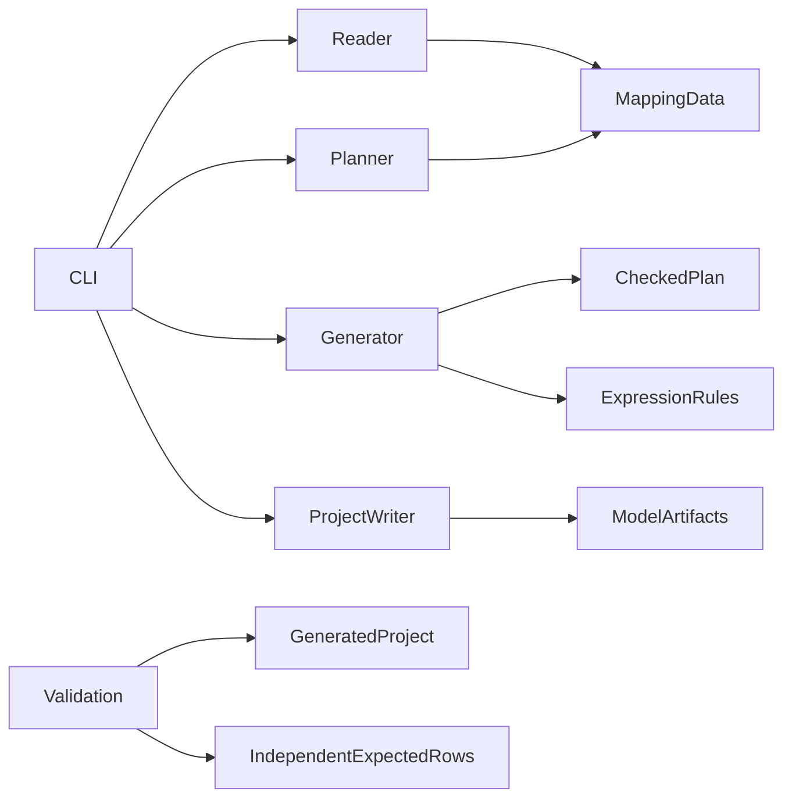

# Architecture Spine — PowerCenter-to-dbt

## Design Paradigm

Pipes-and-filters: read XML into mapping data, resolve and validate its graph, translate supported rules, then write a dbt project. Translation is deterministic and uses no model API or database connection. Verification separately runs dbt against controlled local data.

## Invariants & Rules

### AD-1 — Checked mapping boundary [ADOPTED]

- **Binds:** CAP-1, CAP-2; reader, dependency analysis, SQL generator.
- **Prevents:** SQL generation bypassing unresolved XML connections.
- **Rule:** Reader produces shared Python mapping objects; dependency analysis returns a checked target plan; translation consumes that plan. Exact mapping, instance and port identities and original expressions remain traceable throughout.

### AD-2 — Separation of concerns [ADOPTED]

- **Binds:** All components.
- **Prevents:** File handling, graph meaning and SQL rules becoming interdependent or test expectations repeating converter logic.
- **Rule:** Shared data types own representation. Reader owns XML format; dependency file owns connections/order; expression translation and SQL generation own supported semantics; project writer owns files/configuration; CLI owns arguments/exit status. Independent expected data belongs to tests, never production translator helpers.



Arrows mean “depends on”; generator receives the planner's checked plan, and the writer receives generated artifacts. CLI coordinates these stages. No reader/generator imports the CLI, writer or validation harness.

### AD-3 — Target models and internal steps [ADOPTED]

- **Binds:** CAP-1; SQL generation and output layout.
- **Prevents:** Builders choosing incompatible model granularity or target column order.
- **Rule:** One dbt SQL model per target table. Intermediate operations are named CTEs in that model. Final columns follow XML target field order and their connected values; source/intermediate/target types are separate facts. Deterministic names and quoted identifiers must reject collisions rather than merge objects.

### AD-4 — Explicit relation bindings and runnable output [ADOPTED]

- **Binds:** CAP-1, CAP-4; planner, generator, writer.
- **Prevents:** Guessing dependencies from table-name similarity or emitting models with undeclared inputs.
- **Rule:** Output includes models, dbt project configuration, source declarations and a local DuckDB profile template. Source data is supplied separately. Configuration maps an exact XML source instance key to an exact target instance key when the export lacks cross-mapping links; unbound inputs are declared external sources. Include sample bindings. A generated producer uses `ref`; external inputs use `source`. Planner recursively includes bound generated producers in the checked dependency closure; it must not emit a reference to an absent producer or silently fall back to an external table. All transformation rules remain XML-derived. The planner owns one ModelPlan per target: target key, unique dbt model name, alias/schema options and exposed column/type contract. Generator, writer and inventory consume it without independently deriving names. Validate unknown, ambiguous and conflicting bindings before emission. Every consumed bound input field must match an exposed producer column with a compatible declared type; reject incompatible links rather than invent renames or narrowing conversions.

### AD-5 — Partial results and current-run ownership [ADOPTED]

- **Binds:** CAP-1, CAP-2; planner, writer, CLI.
- **Prevents:** A failed target or stale model being presented as a complete conversion.
- **Rule:** Retain complete independent outputs; transitively block outputs requiring a failed generated producer. Each requested target has one outcome (`emitted`, `unsupported`, `blocked` or `error`) with mapping/target identity, dependencies, reason and artifact path where emitted. A separate full input inventory identifies unselected targets. Any selected failure/blocked target makes the CLI exit nonzero. Refuse a nonempty output destination by default; publish this run's artifacts and inventory together. SQL generation success never means result verification success or core completion.

### AD-6 — Semantic rules and unsupported behavior

- **Binds:** CAP-1, CAP-2; mapping data, expression translation, SQL generation.
- **Prevents:** Plausible SQL silently changing source meaning.
- **Rule:** Preserve connector identities and declared type/default metadata. Parse the supported expression grammar structurally; unknown functions/settings/operators produce contextual diagnostics, never guessed SQL. Implement the bounded rules in research/06-core-semantics-check.md and verify them before support claims: master-outer input roles, null-sensitive IIF/aggregates, storage versus intermediate empty strings, double/decimal/target conversions and current-century YY dates. Session high precision is recorded as NO. Controlled test context does not fix production dates to 2026. Unsupported error-routing variants remain explicit.

### AD-7 — Preparation effects are a separate translation

- **Binds:** CAP-1, CAP-2; setup classification, project writer, local verification.
- **Prevents:** Executing imported commands while reading XML or treating row equality as proof of setup equivalence.
- **Rule:** Classify setup commands and generate equivalent supported dbt preparation steps separately from SELECT logic, including the supplied customer cleanup. Setup classification returns typed intents tied to a target key, never executable raw XML SQL. The project writer alone owns dbt materialization/configuration and preparation-hook rendering from the ModelPlan; SQL generation owns SELECT bodies. A command relation must resolve to the declared original target relation; generated cleanup uses dbt’s resolved `this` relation, not separately reconstructed physical names. Record original relation metadata explicitly when XML omits it. Verify first-run lifecycle, operation order and stale-row removal on repeated local dbt runs. Unsupported required target preparation blocks that target; unrelated workflow commands remain reported as unconverted. Do not claim arbitrary workflow/scheduler equivalence.

### AD-8 — Independent verification and basic-stage evidence

- **Binds:** CAP-2, CAP-3, CAP-4.
- **Prevents:** Compilation, negative-test passes or optional breadth replacing tested conversion and submission evidence.
- **Rule:** Execute generated models in local DuckDB through dbt; compare independent expected columns/values and duplicate counts. Preserve meaningful sorting separately. Test mutations, rejection, preparation and repeatability. Five required targets are a verification floor, not an allowlist. Basic completion also requires measured reports, reproducible commands, all six README obligations, actual prompts and genuine error/detection/correction evidence. One CSV owns actual run history; Markdown summarizes it with tested revision/environment. Never populate synthetic successes or claim universal accuracy.

## Consistency Conventions

| Concern | Convention |
| --- | --- |
| Shared identities | Mapping key = repository/folder/mapping names; instance key adds the exact instance name; port key adds its exact field name. Binding keys use source/target instance keys. Physical source relation metadata is separate. Definitions and instances are distinct; do not strip suffixes. |
| Ownership | Mapping objects are read-only after parsing; checked plans and generated artifacts are separate outputs. One shared representation module is authoritative for all stage interfaces. |
| Errors and outcomes | Diagnostics identify stage, mapping, target and affected instance/port/expression where applicable. Per-target conversion status and measured test status are separate. |
| Configuration | Explicit input/binding options and version-locked dependencies; no credentials, invented client rows or model API configuration. |
| Environment | Local CLI and controlled fixture database; no service deployment, live extraction, production writes or imported-command execution during conversion. XML reads do not fetch external DTDs or expand external entities. |
| Publication | Generated project files are deterministic for identical input/configuration; timestamped measured-run records are separate. Never edit supplied fixtures. |
| Effort and priority | Aim for about four hours from 16:34 Sofia on 22 October; 20:30 is flexible and finishing work in progress is allowed. Complete the tested basic stage and all required evidence before optional expansion. |

## Stack

Existing verified tooling; package runtime pins are owned by the later lockfile.

| Name | Version |
| --- | --- |
| Python | 3.13.16 |
| uv | 0.13.4 |
| BMAD Method | 6.12.4 |

Python XML/graph primitives and dbt/DuckDB local-project fit were checked against primary documentation; source links and inspection limits are in the native memory and research notes. No dependency installation or executable compatibility check is claimed.

## Structural Seed

```text
src/pwc_to_dbt/
  mapping.py        # shared facts, plans, artifacts and diagnostics
  xml_reader.py     # XML product reader
  dependencies.py   # connection/reference checks and graph planning
  expressions.py    # supported expression parsing/translation
  sql.py            # relational model generation
  project.py        # output project/configuration files
  cli.py            # operator commands and exit status
tests/              # controlled fixtures and independent expected results
reports/            # measured CSV history and concise summary
```

This is a code-organization seed, not a second implementation contract. Files do not yet exist. No server, cloud infrastructure, authentication system or production environment is part of this architecture.

## Capability → Architecture Map

| Capability | Lives in | Governed by |
| --- | --- | --- |
| CAP-1 | Reader, mapping data, planner, translator, writer | AD-1–AD-7 |
| CAP-2 | Dependency diagnostics and independent dbt/result tests | AD-1, AD-5–AD-8 |
| CAP-3 | Measured run capture and concise report | AD-8 |
| CAP-4 | Generated project, README, prompts and native BMAD evidence | AD-2, AD-4, AD-8 |

## Deferred

- Exact Python interfaces and expression grammar cases: define together in the native Build implementation contract before coding; no independent builder may invent a competing shared schema.
- Exact compatible pytest, DuckDB and dbt-duckdb package pins: resolve centrally, lock with uv and smoke-check in implementation preparation; all agents use that one environment.
- Additional dialects/products, routers/custom-code/stateful rewrites and runtime scheduling: require a representative fixture and explicit semantic tests; not implicit support from this design.
- Submission and recruiter messaging remain separate authorized actions. Public repository visibility is already approved; current local draft evidence still needs publication.
