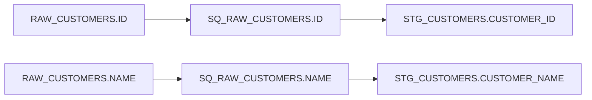
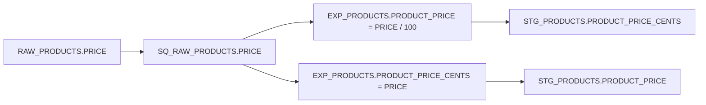

# Reading our PowerCenter XML

Learning and research notes, 22 October 2026. This explains the supplied file before implementation. It does not approve a conversion scope or claim that any target has been converted.

## Evidence and reading guide

**Verified XML facts** below come from fresh inspection of the [unchanged supplied export](../fixtures/powercenter/FLOWLINE_DEMO_JAFFLESHOP.xml). [Provenance](../fixtures/powercenter/provenance.json) records upstream commit `550a222cf73ecca3bd423b1f5770461914889615`. Its verified SHA-256 is:

```text
0c34e0ed2965e117b5de54ca2b1d1333286beb928a6bc63eaf131b04982a3522
```

**Explanations** describe what these structures mean. **Design implications** are consequences to consider later, not implemented behaviour. XML examples retain actual names and values but omit irrelevant attributes and other children; they are excerpts for learning, not complete import files.

## 1. The outer containers

**Verified XML facts:** the file begins with XML version 1.0, Windows-1252 encoding and a reference to `powrmart.dtd`:

```xml
<!DOCTYPE POWERMART SYSTEM "powrmart.dtd">
<POWERMART CREATION_DATE="12/31/2025 20:27:14"
           REPOSITORY_VERSION="187.96">
  <REPOSITORY NAME="REPO_Jaffleshop" VERSION="187"
              CODEPAGE="MS1252" DATABASETYPE="Oracle">
    <FOLDER NAME="FLOWLINE_DEMO_JAFFLESHOP">
      <!-- definitions, mappings and runtime objects occur here -->
    </FOLDER>
  </REPOSITORY>
</POWERMART>
```

**Explanation:** `POWERMART` is this export's root element. `REPOSITORY` names its PowerCenter metadata repository; it is not the client's entire source database. `FOLDER` groups repository objects. Definitions describe data structures and instructions; the XML does not contain customer/order rows.

The actual physical nesting is approximately:

```text
POWERMART
└── REPOSITORY
    └── FOLDER
        ├── SOURCE × 12
        │   └── SOURCEFIELD ...
        ├── TARGET × 16
        │   └── TARGETFIELD ...
        ├── MAPPING × 3
        │   ├── TRANSFORMATION ...
        │   │   ├── TRANSFORMFIELD ...
        │   │   └── TABLEATTRIBUTE ...
        │   ├── INSTANCE ...
        │   └── CONNECTOR ...
        ├── SESSION × 1 (reusable staging session)
        └── WORKFLOW × 1
            ├── SESSION × 2 (core and enriched)
            ├── TASKINSTANCE ...
            └── WORKFLOWLINK ...
```

Other elements also exist; this is not a complete grammar. The export contains 98 transformation definitions and 1,066 mapping connectors.

**Design implication:** a reader must understand this product's object relationships. XML syntax and the presence of a DTD do not make every vendor's ETL export share this structure. `REPOSITORY_VERSION="187.96"` is observed metadata, not a verified PowerCenter product release. The local inspection did not fetch the DTD or run imported commands.

## 2. Definitions, instances and ports

These three terms describe different things:

| Term | Meaning here | Actual example |
|---|---|---|
| Definition | The description of an object | Source definition `RAW_PRODUCTS` |
| Instance | One named use of that object inside a mapping | `RAW_PRODUCTS1` references definition `RAW_PRODUCTS` |
| Port | A named field on a mapping object through which values pass | `SQ_RAW_CUSTOMERS.ID` |

**Verified XML facts:** a source definition gives column metadata:

```xml
<SOURCE NAME="RAW_CUSTOMERS" OWNERNAME="RAW" DATABASETYPE="Oracle">
  <SOURCEFIELD NAME="ID" DATATYPE="varchar2"
               PRECISION="100" NULLABLE="NOTNULL" KEYTYPE="PRIMARY KEY" />
  <SOURCEFIELD NAME="NAME" DATATYPE="varchar2"
               PRECISION="200" NULLABLE="NOTNULL" />
</SOURCE>
```

A target definition describes output columns:

```xml
<TARGET NAME="STG_CUSTOMERS" DATABASETYPE="Oracle">
  <TARGETFIELD NAME="CUSTOMER_ID" DATATYPE="varchar2"
               PRECISION="100" NULLABLE="NULL" />
  <TARGETFIELD NAME="CUSTOMER_NAME" DATATYPE="varchar2"
               PRECISION="200" NULLABLE="NULL" />
</TARGET>
```

Inside a mapping, instances refer to definitions through `TRANSFORMATION_NAME`:

```xml
<INSTANCE NAME="RAW_CUSTOMERS" TRANSFORMATION_NAME="RAW_CUSTOMERS"
          TRANSFORMATION_TYPE="Source Definition" TYPE="SOURCE" />
<INSTANCE NAME="RAW_PRODUCTS1" TRANSFORMATION_NAME="RAW_PRODUCTS"
          TRANSFORMATION_TYPE="Source Definition" TYPE="SOURCE" />
```

**Explanation:** the names often match, but they need not. Two source instances can read the same underlying source definition for different branches. A field called `ID` on one instance is distinct from an `ID` field on another.

**Design implication:** resolve references by the recorded identifiers. Do not remove numeric suffixes or connect ports merely because their names look similar.

## 3. A mapping describes the logical data graph

**Explanation:** a mapping connects source and target objects through transformation objects. PowerCenter's Integration Service uses the mapping instructions when it runs a session. The mapping describes the data rules; it is not itself the running service. This distinction is documented in the [PowerCenter 10.5 Designer Guide, Mappings Overview](https://docs.informatica.com/content/dam/source/GUID-B/GUID-B54ED1F4-60B8-4F11-8E22-48C4BECE109A/30/en/PC_1050_DesignerGuide_en.pdf).

**Verified XML facts:** our three mapping names are:

- `m_FL_JS_STAGING_FULL`
- `m_FL_JS_MARTS_ENRICHED`
- `m_FL_JS_MARTS_CORE`

That is their document order. The runtime workflow links staging → core → enriched. Reading the file from top to bottom does not tell us the logical execution order.

A `TRANSFORMATION` describes an operation; its `TRANSFORMFIELD` children describe ports and, where present, their expressions. `TABLEATTRIBUTE` children configure the operation. For example:

```xml
<TRANSFORMATION NAME="SQ_RAW_CUSTOMERS" TYPE="Source Qualifier">
  <TRANSFORMFIELD NAME="ID" DATATYPE="string" PORTTYPE="INPUT/OUTPUT" />
  <TRANSFORMFIELD NAME="NAME" DATATYPE="string" PORTTYPE="INPUT/OUTPUT" />
  <TABLEATTRIBUTE NAME="Sql Query" VALUE="" />
  <TABLEATTRIBUTE NAME="Source Filter" VALUE="" />
  <TABLEATTRIBUTE NAME="Select Distinct" VALUE="NO" />
</TRANSFORMATION>
```

**Explanation:** a Source Qualifier represents the source rows entering the mapping at runtime. It is a transformation object, not another stored table. It can have settings that affect the read; in this particular qualifier the custom SQL and filter are empty and distinct is disabled. See the [PowerCenter 10.5.1 Getting Started guide, pass-through mapping tutorial](https://docs.informatica.com/content/dam/source/GUID-5/GUID-59000AF8-07AB-4765-8662-1823369AD9C8/29/en/PC_1051_GettingStarted_en.pdf).

A mapping instance names that operation and associates its source:

```xml
<INSTANCE NAME="SQ_RAW_CUSTOMERS" TRANSFORMATION_NAME="SQ_RAW_CUSTOMERS"
          TRANSFORMATION_TYPE="Source Qualifier" TYPE="TRANSFORMATION">
  <ASSOCIATED_SOURCE_INSTANCE NAME="RAW_CUSTOMERS" />
</INSTANCE>
```

**Design implication:** the meaning comes from the operation type, its settings and its connections together. An empty Source Qualifier override in one example does not justify ignoring nonempty overrides in other files.

## 4. Follow exact connector endpoints: customers

**Verified XML facts:** these are the actual connector endpoints, shown in logical order:

```xml
<CONNECTOR FROMINSTANCE="RAW_CUSTOMERS" FROMFIELD="ID"
           TOINSTANCE="SQ_RAW_CUSTOMERS" TOFIELD="ID" />
<CONNECTOR FROMINSTANCE="SQ_RAW_CUSTOMERS" FROMFIELD="ID"
           TOINSTANCE="STG_CUSTOMERS" TOFIELD="CUSTOMER_ID" />
<CONNECTOR FROMINSTANCE="RAW_CUSTOMERS" FROMFIELD="NAME"
           TOINSTANCE="SQ_RAW_CUSTOMERS" TOFIELD="NAME" />
<CONNECTOR FROMINSTANCE="SQ_RAW_CUSTOMERS" FROMFIELD="NAME"
           TOINSTANCE="STG_CUSTOMERS" TOFIELD="CUSTOMER_NAME" />
```



**Explanation:** a connector carries values between particular fields on particular instances. This trace is called field lineage. Here it explains a rename even though no Expression transformation performs the rename.

**Design implication:** preserve `(instance, field)` identity throughout the trace. The physical parent/child XML tree stores objects; the connectors define a separate logical graph between them. That graph can branch, merge and produce several targets from one mapping.

## 5. A richer example: expressions and surprising products wiring

**Verified XML facts:** `RAW_PRODUCTS.PRICE` and `TYPE` feed `SQ_RAW_PRODUCTS` and then the input ports of `EXP_PRODUCTS`. That Expression transformation defines these output ports:

```xml
<TRANSFORMFIELD NAME="PRODUCT_PRICE" PORTTYPE="OUTPUT"
                EXPRESSION="PRICE/100" />
<TRANSFORMFIELD NAME="PRODUCT_PRICE_CENTS" PORTTYPE="OUTPUT"
                EXPRESSION="PRICE" />
<TRANSFORMFIELD NAME="IS_FOOD_ITEM" PORTTYPE="OUTPUT"
                EXPRESSION="IIF( UPPER(LTRIM(RTRIM(TYPE))) = 'JAFFLE', 1, 0 )" />
```

The food expression trims the type value, converts it to uppercase, then selects 1 or 0. The XML also defines a corresponding beverage condition.

Crucially, the target price connectors are crossed relative to those port names:

```xml
<CONNECTOR FROMINSTANCE="EXP_PRODUCTS" FROMFIELD="PRODUCT_PRICE"
           TOINSTANCE="STG_PRODUCTS" TOFIELD="PRODUCT_PRICE_CENTS" />
<CONNECTOR FROMINSTANCE="EXP_PRODUCTS" FROMFIELD="PRODUCT_PRICE_CENTS"
           TOINSTANCE="STG_PRODUCTS" TOFIELD="PRODUCT_PRICE" />
```



**Explanation:** for a normal numeric input PRICE of 1250, tracing these expressions and connectors gives target `PRODUCT_PRICE_CENTS = 12.5` and `PRODUCT_PRICE = 1250`, before any final type/precision effects. This example illustrates the recorded wiring; it is not a PowerCenter runtime test.

**Design implication:** names suggest business intent, but connectors describe the supplied behaviour. A converter must not silently repair this wiring to match a conventional cents/dollars model. Any suspected source defect should be reported separately from faithful translation. This is also why comparing with a Jaffle Shop reference requires checking the actual rules.

## 6. Sessions and workflows: how the mapping is run

**Verified XML facts:** the staging session references its mapping explicitly:

```xml
<SESSION NAME="s_FL_JS_STAGING_FULL"
         MAPPINGNAME="m_FL_JS_STAGING_FULL" REUSABLE="YES">
  <!-- source/target and runtime configuration omitted -->
</SESSION>
```

The workflow contains task instances and explicit task links:

```xml
<WORKFLOWLINK FROMTASK="Start" TOTASK="s_FL_JS_STAGING_FULL" CONDITION="" />
<WORKFLOWLINK FROMTASK="s_FL_JS_STAGING_FULL"
              TOTASK="s_FL_JS_MARTS_CORE" CONDITION="" />
<WORKFLOWLINK FROMTASK="s_FL_JS_MARTS_CORE"
              TOTASK="s_FL_JS_MARTS_ENRICHED" CONDITION="" />
```

There is also a final link from the enriched session to command task `cmd_FL_JS_CREATE_RPT_VIEWS`.


**Explanation:** the mapping defines transformation rules. A session supplies the task and runtime settings to execute a mapping. The workflow connects sessions and other tasks, with ordering and potentially conditions. The [PowerCenter Workflow Basics Guide](https://docs.informatica.com/content/dam/source/GUID-7/GUID-7D547585-D0CF-4692-9CB1-9AEF344711E5/36/en/PC_105_WorkflowBasicsGuide_en.pdf) explains this task-orchestration role.

**Design implication:** translating a mapping into SQL models does not automatically translate its entire runtime workflow. Our export even includes target-instance `Pre SQL` containing `TRUNCATE TABLE STG.STG_CUSTOMERS`. This is metadata inspected as text; nothing was executed. Table replacement, pre/post commands, connections and scheduling need an explicit boundary rather than accidental execution or a claim that all runtime behaviour was preserved.

## Primary references and access scope

| Source | What was checked for this note | Limit |
|---|---|---|
| [PowerCenter 10.5 Designer Guide](https://docs.informatica.com/content/dam/source/GUID-B/GUID-B54ED1F4-60B8-4F11-8E22-48C4BECE109A/30/en/PC_1050_DesignerGuide_en.pdf), Mappings Overview, printed p. 108 | Official indexed passage: source/target definitions, transformation objects, links and session use | Relevant passage, not a full-guide audit or runtime test |
| [PowerCenter 10.5 Repository Guide](https://docs.informatica.com/content/dam/source/GUID-1/GUID-11B6F8F7-0FDC-4B5C-87B4-FCDD4C933B23/23/en/PC_105_RepositoryGuide_en.pdf), Exporting and Importing Objects, printed p. 126 | Official indexed passage: repository objects can be exported to XML and imported | Does not establish a universal cross-product XML schema |
| [PowerCenter 10.5.1 Getting Started](https://docs.informatica.com/content/dam/source/GUID-5/GUID-59000AF8-07AB-4765-8662-1823369AD9C8/29/en/PC_1051_GettingStarted_en.pdf), pass-through mapping, printed p. 47 | Official indexed passage: Source Qualifier and input/output ports | Explains terminology; not proof of the supplied export's exact application release |
| [PowerCenter 10.5 Workflow Basics Guide](https://docs.informatica.com/content/dam/source/GUID-7/GUID-7D547585-D0CF-4692-9CB1-9AEF344711E5/36/en/PC_105_WorkflowBasicsGuide_en.pdf), Workflows Overview, printed p. 35 | Official indexed passage: workflows connect and run session and command tasks | No workflow executed |

The XML examples, nesting, counts, crossed product-price connectors and runtime-object names were checked against the local supplied file, not inferred from these guides. Research can explain a construct without proving complete conversion equivalence.
