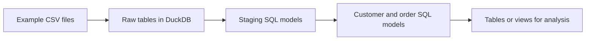

# What the Jaffle Shop DuckDB project provides

Researched 22 October 2026. Learning/reference note, not a converter implementation or test result.

## Purpose

The linked repository is a small dbt demonstration about a fictional shop. It provides example data, SQL transformations and a local database configuration. It is not a running shop application or a converter. The README calls it a self-contained playground rather than a production best-practice template. [Project README](https://github.com/dbt-labs/jaffle_shop_duckdb).

DuckDB is the database that executes the SQL. dbt arranges and builds the models. Jaffle Shop is the example business whose data is being transformed.

## Read the repository in this order

| File or folder | What it contributes |
|---|---|
| `seeds/` | Small example CSV datasets that can be loaded as tables. |
| `models/staging/` | Initial SQL models that reference the raw tables and rename/prepare columns. |
| `models/customers.sql` | Combines customer data with order and payment summaries. |
| `models/orders.sql` | Produces an order-level analytical model. |
| `dbt_project.yml` | Project/model configuration. |
| `profiles.yml` | Database connection configuration for the local example. |

Conceptually, it works like this:

dbt calls a version-controlled CSV loaded with `dbt seed` a **seed**. The example uses seeds for convenience; ordinary production source ingestion is a separate concern. [Official seed documentation](https://docs.getdbt.com/docs/build/seeds).

## One concrete file

The staging customer model reads the raw customer seed and maps `id` to `customer_id`, retaining first and last names. [Inspected staging model](https://github.com/dbt-labs/jaffle_shop_duckdb/blob/duckdb/models/staging/stg_customers.sql).

The customer model then reads staging customers, orders and payments. It calculates the first/latest order, order count and a payment-based lifetime value, then joins those summaries to customers. [Inspected customer model](https://github.com/dbt-labs/jaffle_shop_duckdb/blob/duckdb/models/customers.sql).

`{{ ref('stg_customers') }}` is dbt's way of referring to another model. dbt resolves the database relation and records the dependency so it can build models in a suitable order. It is not ordinary SQL syntax passed unchanged to DuckDB. [Official `ref` documentation](https://docs.getdbt.com/reference/dbt-jinja-functions/ref).

## Why Infinite Lambda links it

It gives us a concrete example of dbt models and a local environment in which to inspect results. We can learn the project structure and compare compatible transformations. The assignment assesses whether our converter derives rules from XML; copying this project's final SQL would not establish that.

The supplied XML uses a related modern Jaffle Shop variant with products, supplies, items and stores. The classic DuckDB example uses customers, orders and payments. They are different editions of a teaching example, not different real clients. Schema/rule differences—and the source's exact connectors—must be reconciled before a result comparison is valid. [Infinite Lambda source description](https://github.com/infinitelambda/flowline-pwc-demo), [modern Jaffle Shop](https://github.com/dbt-labs/jaffle-shop).

## Reading scope and limits

Read the relevant README sections, full staging/customer model files and official seed/ref explanations. Prior PRD research inspected order-model and dependency metadata; its [source-access record](../_bmad-output/planning-artifacts/prds/prd-powercenter-to-dbt-2026-10-22/reconcile-official-references.md) gives details. No reference project was installed or executed during this research. Mutable upstream links should be pinned to a commit when used as a reproducible test oracle.
